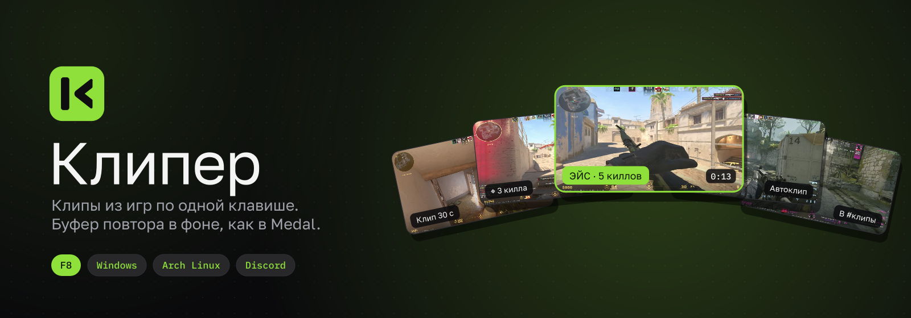
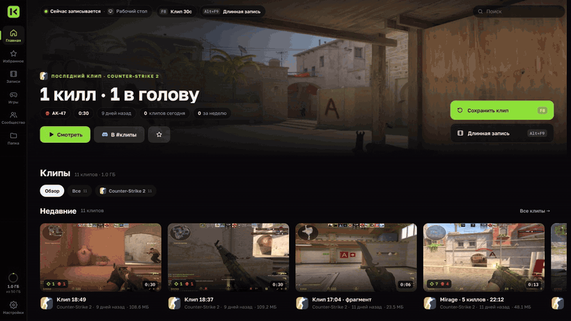
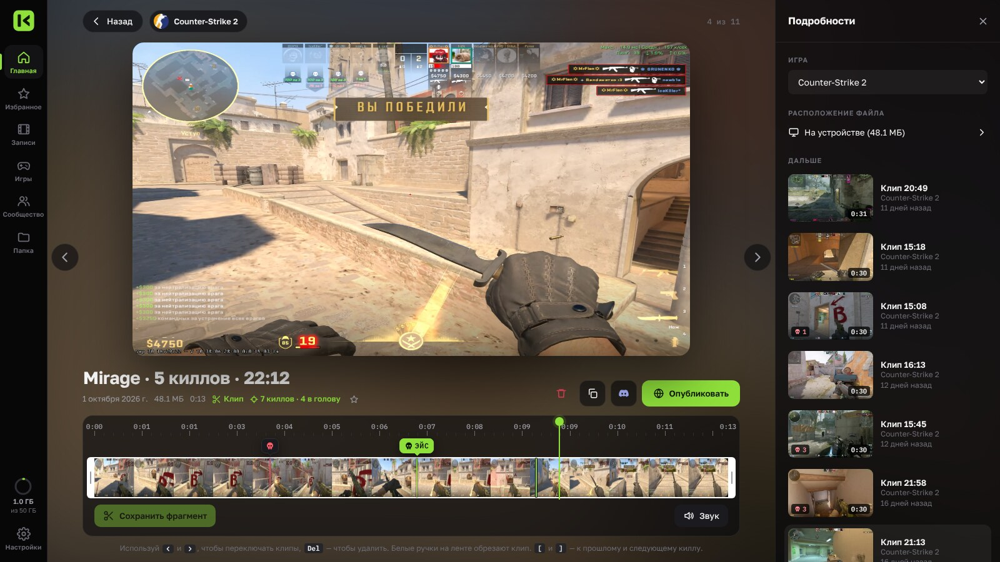
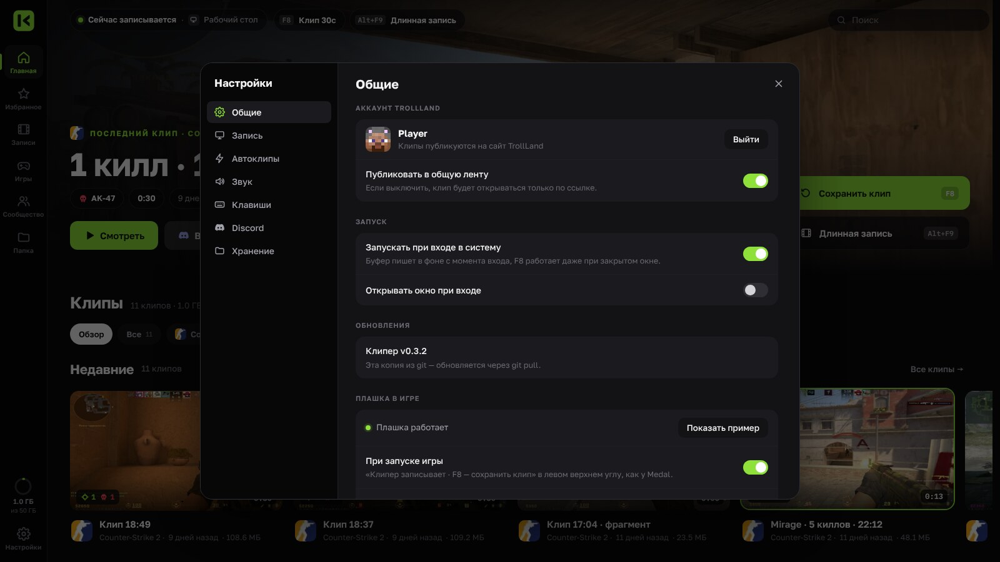

<div align="center">



<br>

[](https://github.com/Flenstick/kliper-releases/releases/latest)
[](https://github.com/Flenstick/kliper-releases/releases)


**Клипер всё время держит последние минуты игры в памяти. Случилось что-то крутое: жмёшь F8,
и последние 30 секунд уже лежат клипом. Как Medal, только свой: без рекламы, аккаунтов и лишней нагрузки.**

[**⬇ Скачать для Windows**](https://github.com/Flenstick/kliper-releases/releases/latest) &nbsp;·&nbsp;
[**Установить на Linux**](#linux-arch-cachyos-endeavouros-manjaro) &nbsp;·&nbsp;
[Все версии](https://github.com/Flenstick/kliper-releases/releases)

<br>



</div>

<br>

## Клавиши

| Клавиша | Что делает |
|:---:|---|
| <kbd>F8</kbd> | Сохранить последние 30 секунд |
| <kbd>Shift</kbd> + <kbd>F8</kbd> | Сохранить весь буфер (до 2 минут) |
| <kbd>Alt</kbd> + <kbd>F9</kbd> | Начать или остановить длинную запись |
| <kbd>Alt</kbd> + <kbd>F11</kbd> | Открыть Клипер |

## Что умеет

<table>
<tr>
<td width="50%" valign="top">

### ⏪ Буфер повтора
Запись идёт в фоне на видеокарте (NVENC, AMF, Quick Sync), игра не проседает.
Клип сохраняется мгновенно, без перекодирования, и раскладывается по папкам игр.

</td>
<td width="50%" valign="top">

### 🎯 Засечки киллов в CS2
Каждый твой килл отмечается на ленте клипа: хедшоты, мультикиллы, эйсы.
Клик по засечке перематывает к моменту, клавиши <kbd>[</kbd> и <kbd>]</kbd> переходят между киллами.
Автоклипы по числу киллов за раунд.

</td>
</tr>
<tr>
<td valign="top">

### ✂️ Обрезка и Discord
Белые ручки на ленте сохраняют нужный фрагмент. «Скопировать для Discord»
сжимает клип в 10 МБ так, чтобы качество осталось максимальным, и сразу кладёт файл в буфер обмена.

</td>
<td valign="top">

### 🎮 Игры сами по себе
Клипер сам узнаёт игру: Steam, Roblox (с названием плейса), Minecraft и другие.
Плашка поверх игры, статус в Discord и статистика времени в играх.

</td>
</tr>
<tr>
<td valign="top">

### 🌐 Сообщество
Можно опубликовать клип на сайте TrollLand и одной кнопкой отправить в канал #клипы.
Чужие клипы смотришь прямо в Клипере.

</td>
<td valign="top">

### 🔄 Обновляется сам
Новые версии ставятся тихо, когда ты не играешь. На Linux Клипер предлагает
обновиться и сам ставит пакет через pacman.

</td>
</tr>
</table>

<div align="center">

<br><br>

</div>

## Установка

### Windows 10 / 11

1. Скачай **`Kliper-Setup-….exe`** со страницы [последней версии](https://github.com/Flenstick/kliper-releases/releases/latest) и запусти. Права администратора не нужны.
2. Значок Клипера появится у часов (правый клик — меню). Дальше Клипер стартует вместе с Windows.

> Windows может показать «Windows защитил компьютер»: нажми «Подробнее» → «Выполнить в любом случае».

### Linux (Arch, CachyOS, EndeavourOS, Manjaro)

Одна команда ставит и потом обновляет Клипер. Всё нужное (gpu-screen-recorder, ffmpeg, GTK, WebKit) pacman докачает сам:

```sh
curl -fsSL https://raw.githubusercontent.com/Flenstick/kliper-releases/main/install.sh | sh
```

Потом открой «Клипер» в меню приложений: служба запустится и дальше будет стартовать со входом в систему.

- **GNOME**: клавиши назначатся сами, плашка поверх игры заработает после перезахода в систему.
- **KDE Plasma**: клавиши и плашка заработают после перезахода. Поменять клавиши: Параметры системы → Комбинации клавиш → Клипер.
- Видеокарты NVIDIA, AMD и Intel (для Intel нужен пакет `intel-media-driver`). Лучше всего работает в сеансе Wayland.

<details>
<summary>Поставить пакет вручную</summary>

Скачай `kliper-…-any.pkg.tar.zst` из [релиза](https://github.com/Flenstick/kliper-releases/releases/latest) и выполни
`sudo pacman -U kliper-*-any.pkg.tar.zst`. Ставь из скачанного файла, а не `pacman -U <ссылка>`:
по ссылке pacman требует подпись `.sig` и падает с ошибкой 404.

</details>

## Что-то не работает?

- **Windows:** пришли файлы `kliper.log` и `selftest.json` из папки `%LOCALAPPDATA%\Kliper`.
- **Linux:** пришли вывод `kliper selftest` и `journalctl --user -u kliper -n 100`.

<div align="center">

<br><br>
<sub>Клипер · сделано MrFlen для TrollLand</sub>
</div>
